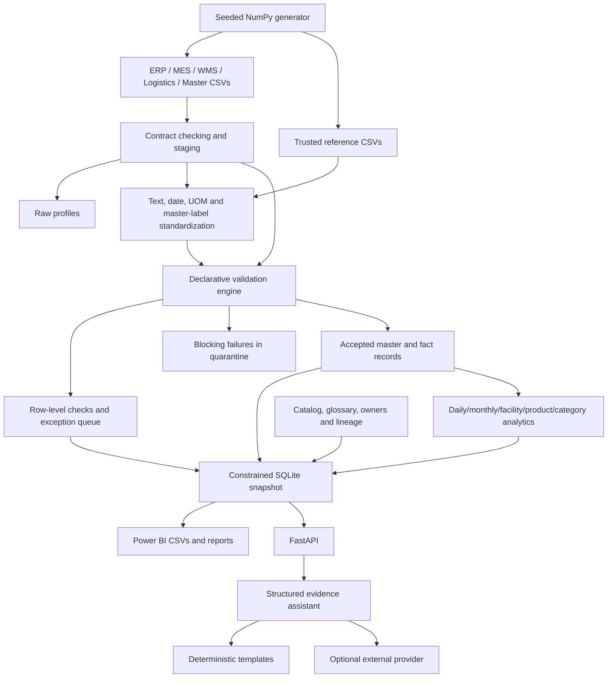

# Implemented architecture

`src/data/generate.py` writes reproducible raw sources and trusted references, with a defect-operation receipt. ERP customer/product snapshots can disagree with MDM reference labels. `src/pipeline/ingestion.py` rejects missing or unexpected columns. Every ingested row carries `source_row`, so duplicate keys still have distinct traceable occurrences.

`src/pipeline/standardization.py` uppercases text, trims whitespace, maps unit/facility aliases, parses dates/numbers and repairs canonical labels using existing master IDs. It does not invent missing IDs, categories or quantities. Original CSV values remain in staging. `src/profiling/engine.py` profiles all core fields at raw, cleaned and curated stages.

`src/quality/engine.py` evaluates active JSON rules, emits results and exceptions, and records each row-level pass/fail. Parents load before children; membership is checked against accepted parents. Thus a rejected product can quarantine an otherwise syntactically valid fact. `src/analytics/kpis.py` uses curated facts, aggregates event measures and calculates inventory observation snapshots.

`src/db/store.py` builds a fresh SQLite file with primary keys, foreign keys, indexes, required-field and range constraints, verifies integrity, closes connections and atomically replaces the published snapshot. A failed build leaves the old database usable. CSV exports happen after database publication; an export failure can be retried with `report`. Whole-folder CSV exports are not an atomic transaction. Stop the API before rebuilding on Windows; avoid concurrent writers.

The run hash includes CSV contents, relative source filenames, rule definitions, weights, as-of date and Python source files. Wall-clock execution timestamps do not affect scores or identities. Same-input runs preserve workflow notes. This intentionally replaces the last complete snapshot rather than accumulating duplicate facts or run history. Logs preserve execution stages.

FastAPI opens and closes a connection per request. Filters and updates use bound SQL parameters; profiling table names are checked against contracts. Assistant tools use fixed read-only SELECT statements. The optional provider receives bounded synthetic aggregates and matching definitions, never environment credentials in the context.

Practical boundaries: local batch processing, one writer, no authentication, no streaming, no cloud services, no migration framework, no production freshness SLA. These keep the project explainable and fully runnable for an entry-level portfolio.
